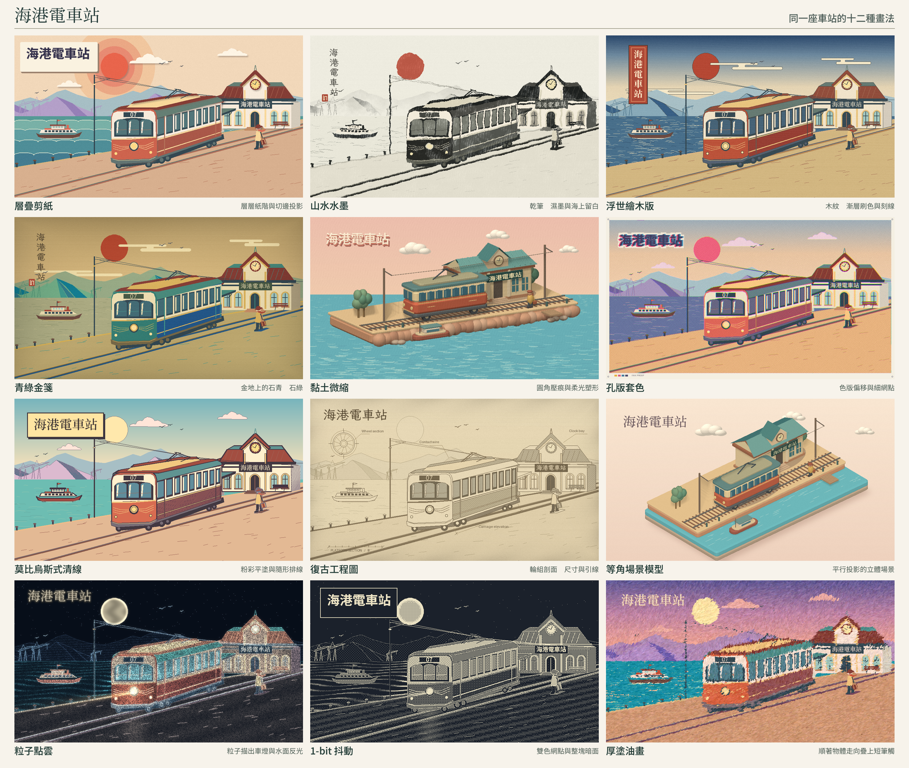

# ProgramAnimation-skills

把一句動畫想法做成可播放的影片。先分輪訪談，把劇本與分鏡寫在對話裡。定稿後用真實預覽選畫法，再用程式生成畫面、旁白、音樂和音效。題材、片長、螢幕方向與製作引擎都可依委託調整。



[逐款看大圖、範例原始碼與取捨](skills/program-animation/references/styles.md) · [12 款「海港電車站」題字與換字方法](skills/program-animation/references/lettering.md)

## 安裝與使用

將這兩個技能資料夾一起放入 Codex 的 skills 目錄，保留原資料夾名稱。首次安裝可執行：

```sh
git clone https://github.com/shoung/ProgramAnimation-skills.git
cd ProgramAnimation-skills
mkdir -p "${CODEX_HOME:-$HOME/.codex}/skills"
cp -R skills/animation-grill skills/program-animation "${CODEX_HOME:-$HOME/.codex}/skills/"
```

開啟新的 Codex 對話，輸入「用 `$program-animation` 幫我做一支給家人看的直式短片。我最記得外婆每天拉開早餐店鐵門的聲音。」也可以用 `$animation-grill` 先把想法問清楚。

每個 AI agent session 第一次使用任一技能時，會先檢查原倉庫的版本，再顯示 SHOUNG ASCII 標記、歡迎詞和使用方式。若有新版，會先讓你選擇更新或沿用目前版本。較早安裝的版本可先從原倉庫取得新版，再依上方步驟同步更新兩個資料夾。有自訂內容時，先比對或備份再複製。

| 技能 | 工作 |
|---|---|
| [program-animation](skills/program-animation/SKILL.md) | 依[分鏡方法](skills/program-animation/references/storyboard.md)把故事拆成可審閱的鏡頭，再選畫法、製作影音並逐幀驗片。 |
| [animation-grill](skills/animation-grill/SKILL.md) | 每輪可合併多個獨立問題，下一輪依回答追問。初次訪談整理創作簡報，修改時整理時間碼、修改目標、驗收方式及保留項目，等同意後才動手。 |

## 試畫一鏡

以下指令從本倉庫根目錄執行。需 Python 3.9 以上；輸出影片另需含 libx264 的 FFmpeg 及 ffprobe。安裝技能和觀看隨附的 PNG 可直接使用上方步驟。

```sh
python3 -m venv .venv
. .venv/bin/activate
python -m pip install -r skills/program-animation/requirements.txt
python skills/program-animation/scripts/render.py --style one-bit --png /tmp/harbor-tram.png
python skills/program-animation/scripts/render.py --style paper-cut --seconds 4 --fps 24 --video /tmp/harbor-tram.mp4
```

[聲音合成範例、空白幀復原與成片驗證](skills/program-animation/references/production.md)

發布新版時，同步提高 [VERSION](skills/program-animation/VERSION) 的版本號，讓使用者在下一個 session 收到更新提示。
